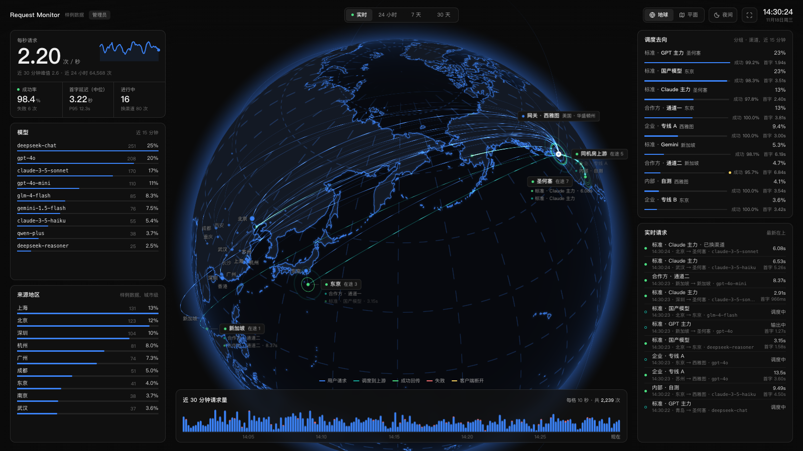
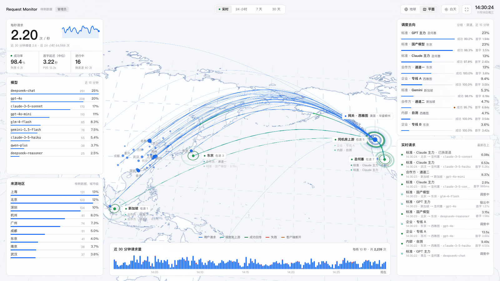
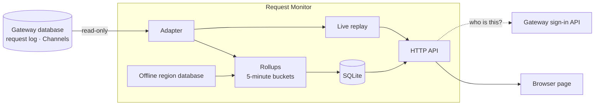

<div align="center">

<a href="https://lynshen.org"></a>

# Request Monitor

**See every dispatch of your LLM API gateway: where a request came from, which upstream served it, and whether it worked.**

[](LICENSE)
[](server/go.mod)
[](web/package.json)
[](web/src/scene)

[简体中文](README.md) · English

Built and open-sourced by [LynShen Inc.](https://lynshen.org)

</div>

<p align="center">
  
</p>

Request Monitor shows how an LLM API gateway dispatches requests. It draws the gateway's request log on a globe or a flat map: each request leaves the user's region, reaches the gateway, and is dispatched to a Channel of a Group and the upstream behind it. Around the map are requests per second, success rate, time to first token, and the rankings of models and Channels; below it is a timeline that replays the last 24 hours, 7 days, or 30 days.

It runs as a separate service and needs no change to the gateway. It reads the gateway's request log and Channel tables through a read-only database account, keeps its own 5-minute rollups, and serves the page and its API from one process.

> The Groups, Channels, cities, and figures in the screenshots are the synthetic sample of the preview.

The page's copy is in Simplified Chinese.

## Features

- **Dispatch on a map.** A globe and a flat map, with a day and a night theme that switch by the time of day. Each request is a line from its region to the gateway and on to an upstream; dispatch, successful return, failure, and client disconnect each have their colour, and a request that changed Channel is marked.
- **Live and replay.** The timeline replays 24 h / 7 d / 30 d and can play, pause, and scrub. When a gateway writes its log row only after a request ends, the service replays each request with its recorded timings and the page labels the mode "near real time".
- **Every place opens.** Hover a user region, the gateway, or an upstream location for a summary; click it for requests, success rate, model and Channel breakdown, and the latest finished requests.
- **Per-role views.** The service recognises admins, users, and guests from the gateway's own sign-in. Restricted Groups are merged on the server and show only their Group name to non-admins; guests can be kept out entirely.
- **Nothing sensitive reaches the browser.** No client IP, user, key, request or response body, error detail, or upstream host name is sent. The server turns an IP into a region with a local offline database, down to the city; a city with fewer than 3 distinct clients in a day is shown as its province.
- **Missing is shown as missing.** What the gateway does not record is shown as "not recorded" (`未记录`), never filled with made-up data.
- **Easy to deploy.** One Go executable with the page built in, and SQLite inside. No other database, cache, or queue.

<p align="center">
  
</p>

## Supported gateways

| Gateway | Status |
| --- | --- |
| LynShen | Supported (`gateway.kind = "lynshen"`): replay and identification; the live endpoint exists, the page does not read it yet |
| sub2api | Planned |
| new-api | Planned |

A new gateway needs one adapter (`server/internal/gateway`); section 2 of [`docs/spec-service.md`](docs/spec-service.md) says what it must provide.

## Quick start

### 1. The preview (no gateway needed)

Needs [Bun](https://bun.sh). The preview generates synthetic data in the browser and sends no network request.

```bash
cd web
bun install
bun run dev            # open http://localhost:5173
bun run build:single   # writes dist-single/request-monitor.html; open it from disk
```

### 2. A demo service

Needs Go 1.26 and Bun. `make build` builds the page first and then embeds it in one executable.

```bash
cd server
make build                                         # writes bin/request-monitor
bin/request-monitor devseed -dir demo              # writes an invented demo gateway and a configuration
bin/request-monitor serve -config demo/config.toml
```

Then open `http://127.0.0.1:8787` (change `listen` in the configuration if the port is taken). Every name and number in the demo gateway is invented.

### 3. A real gateway

1. Create a read-only account in the gateway's PostgreSQL that can read only the columns the service needs. A read replica is best.

   ```sql
   CREATE ROLE request_monitor_ro LOGIN PASSWORD 'change-me';
   GRANT CONNECT ON DATABASE gateway TO request_monitor_ro;
   GRANT USAGE ON SCHEMA public TO request_monitor_ro;
   GRANT SELECT (id, created_at_unix_ms, request_ip, model, provider_id, status, ttfb_ms,
                 duration_ms, error_code, request_kind, tried_providers_json) ON request_logs TO request_monitor_ro;
   GRANT SELECT (id, group_id, public_name, channel_public_name, channel_base_url) ON monoize_providers TO request_monitor_ro;
   GRANT SELECT (id, name, account_class) ON monoize_groups TO request_monitor_ro;
   ALTER ROLE request_monitor_ro SET default_transaction_read_only = on;
   ```

   Only live mode reads `id` and `tried_providers_json`; leave them out if you set `live.enabled = false`.

2. Write a configuration from [`server/config.example.toml`](server/config.example.toml). The connection string can go in the environment variable `REQUEST_MONITOR_GATEWAY_DSN` instead of the file.

3. Start it:

   ```bash
   REQUEST_MONITOR_GATEWAY_DSN='postgres://request_monitor_ro:…@127.0.0.1:5432/gateway' \
     bin/request-monitor serve -config /etc/request-monitor/config.toml
   ```

   On first start it reads the last 30 days of history (`ingest.backfill_days`), then catches up every 30 seconds.

4. Put a reverse proxy with TLS in front of it. The service issues read statements only and listens on loopback by default.

5. Check it: `bin/request-monitor reconcile -config … -days 30` compares every rollup cell with the gateway's own counts and fails on any difference.

### Identification and guests

Set `gateway.api_url` (the gateway's own API) and serve Request Monitor from a subdomain of the gateway's parent domain. The browser then sends the gateway's sign-in along, and the service asks the gateway who the visitor is; it caches each answer for at most 60 seconds.

To keep out visitors who are not signed in, set `access.guests = false` and `access.login_url`: they see a sign-in prompt and return to the page after signing in. The service handles the visitors' sign-in credentials, so run it only on a machine trusted as much as the gateway.

## Configuration

[`server/config.example.toml`](server/config.example.toml) lists every key. A misspelt or unknown key is an error. The common ones:

| Key | Default | Purpose |
| --- | --- | --- |
| `listen` | `127.0.0.1:8787` | Listen address. `REQUEST_MONITOR_LISTEN` overrides it |
| `data_dir` | `data` | Where the service keeps its own database, `request-monitor.db` |
| `timezone` | `UTC` | Where a day begins; region client counts are per day |
| `gateway.kind` | `lynshen` | The adapter |
| `gateway.dsn` | required | Read-only connection string of the gateway database. `REQUEST_MONITOR_GATEWAY_DSN` overrides it |
| `gateway.api_url` | empty | The gateway's own API, used for identification only; empty makes every visitor a guest |
| `gateway.name` `region` `lat` `lon` | | Where the gateway is on the map |
| `access.guests` / `access.login_url` | `true` / empty | Whether guests may open the page, and where to sign in otherwise |
| `geo.mmdb` | empty | A MaxMind-format city database: DB-IP City Lite (free, CC BY 4.0) or GeoLite2-City |
| `geo.min_clients` | `3` | Distinct clients a region needs in a day to be shown on its own |
| `ingest.backfill_days` | `30` | Days of history read on first start (1 to 90) |
| `live.enabled` | `true` | Live mode by replay |
| `screen.title` `note` `logo_day_file` `logo_night_file` | `Request Monitor` | Page title, a note beside it, and the day and night logos |
| `[[upstream]]` | | Pin the location of upstreams by host name, or hide them |

## How it works



- **The adapter** issues `SELECT` statements only, each in a read-only transaction. It never reads users, keys, error messages, or bodies.
- **Rollups** are kept per 5 minutes: request counts by route and status, by user region, and by model, plus a time-to-first-token histogram per bucket. Replay reads the rollups only; opening the page never scans the gateway's log table.
- **Live mode** replays each new request with its recorded time to first token and duration, because the gateway writes the row when the request ends. The screen is therefore behind reality by the length of a request and shows no request that is still running.
- **Identity** is decided on the server, and every endpoint answers for the visitor's role. A role sent by the page is never trusted.

## Using the page

URL parameters: `?view=2d` (flat map), `?range=24h|7d|30d`, `?theme=auto|day|night`, `?day=7-18` (daytime hours), `?as=user|guest` (act as a user or guest, preview only), `?rate=10` (ten times the sample traffic).

Keys: `1` live, `2` / `3` / `4` replay, `D` globe / flat map, `L` auto / day / night, Space play / pause, `Esc` close the detail card. Drag to turn the globe; scroll or pinch to zoom. The map frames the gateway, the upstreams, and the main user regions by itself.

Your own title and logo: set `[screen]` in the service; for the single-file preview, write a `config.json` (fields in `web/src/core/config.ts`) and run `bun run build:single -- --config /path/to/config.json`.

## Status

| Part | Status |
| --- | --- |
| Page (`web/`) | Works, on the built-in synthetic sample (preview) or on the service below |
| Service (`server/`) | Replay and identification work; 30 days of rollups have matched a real LynShen gateway's own counts cell by cell |
| Live mode | The service provides it (`/api/live`); the page does not read it yet, so it opens on the 24-hour replay |
| sub2api, new-api | Adapters not written yet |

## Repository layout

```text
web/                    the page (React + three.js, built with Vite)
  src/core/             data contract (model.ts, identity.ts, config.ts), engine, geo helpers
  src/scene/            WebGL scene, shaders, automatic framing, day and night themes
  src/ui/               panels, timeline, place details
  src/preview/          synthetic sample and simulator
  src/net/              data source that reads the service
server/                 the service (Go): reads the gateway, keeps rollups, serves the API and the page
  cmd/request-monitor/  command line: serve, devseed, reconcile
  internal/gateway/     adapters
docs/                   specifications: spec-screen.md (page), spec-service.md (service)
```

## Development

```bash
cd server && go vet ./... && go test ./...
cd web && bun run lint && bun run build
```

The adapter tests run on SQLite by default; point `REQUEST_MONITOR_TEST_PG_DSN` at an empty PostgreSQL database they may fill to run them on PostgreSQL as well. Behaviour changes start in the specifications: [`docs/spec-screen.md`](docs/spec-screen.md) and [`docs/spec-service.md`](docs/spec-service.md).

To develop the page against a running service:

```bash
cd web
REQUEST_MONITOR_API=http://127.0.0.1:8787 bun run dev
```

## License

[Apache-2.0](LICENSE). Third-party data and software are listed in [`NOTICE`](NOTICE): coastlines from Natural Earth, and by default the DB-IP City Lite region database (CC BY 4.0; the page credits DB-IP at the bottom right while it is in use).

## About LynShen

<a href="https://lynshen.org">
  <picture>
    <source media="(prefers-color-scheme: dark)" srcset="docs/images/lynshen-logo-night.svg">
    
  </picture>
</a>

Request Monitor is made by [LynShen Inc.](https://lynshen.org) It began as the operations screen of the LynShen gateway and was split out as its own open-source project so that other gateways can use it too.

Copyright © 2026 LynShen Inc.
