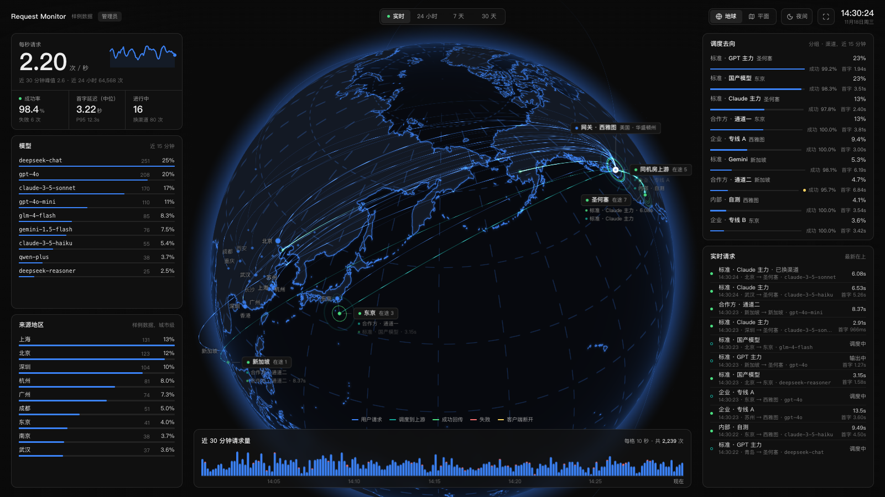
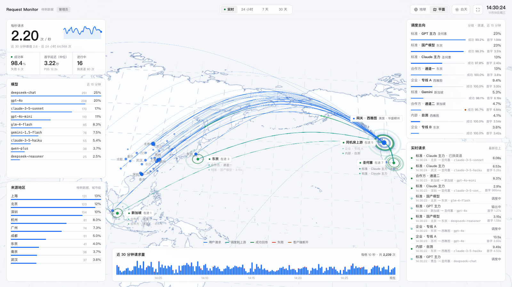
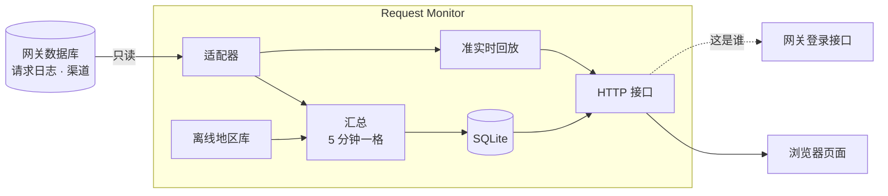

<div align="center">

<a href="https://lynshen.org"></a>

# Request Monitor

**看清 LLM API 网关的每一次调度：请求从哪来、派给了哪条上游、成没成功。**

[](LICENSE)
[](server/go.mod)
[](web/package.json)
[](web/src/scene)

简体中文 · [English](README.en.md)

由 [LynShen Inc.](https://lynshen.org) 开发并开源

</div>

<p align="center">
  
</p>

Request Monitor 是给 LLM API 网关用的请求调度监控。它把网关的请求日志画在地球或平面地图上：每个请求从用户所在的地区出发，到达网关，再被调度到某个分组下的某条渠道和它所在的上游。四周是每秒请求数、成功率、首字延迟、模型和渠道排行，底下是时间轴，可以回看最近 24 小时、7 天、30 天。

它是一个独立的服务，不用改网关的代码：用一个只读数据库账号读网关的日志表和渠道表，自己存 5 分钟一格的汇总，再把页面和接口一起提供出来。

> 截图里的分组、渠道、城市和数字都是预览自带的合成数据。

## 功能

- **在地图上看调度**：地球和平面两种视图，白天和夜间两套配色按时间自动切换。每个请求是一条从来源地区到网关、再到上游的线；调度、成功回传、失败、客户端断开各有颜色，换过渠道的请求会标出来。
- **实时和回溯**：时间轴回看 24 小时 / 7 天 / 30 天，可以播放、暂停、拖动。网关只在请求结束后写日志时，服务按记录下来的耗时把请求「回放」一遍，页面标为「准实时」。
- **点开每个地点**：来源地区、网关、上游所在地都可以悬停看摘要、点击看详情：请求数、成功率、模型和渠道分布、最近完成的请求。
- **按身份显示**：服务借网关自己的登录状态认出管理员、普通用户和访客。受限分组对非管理员只显示分组名，在服务端就合并好；也可以干脆不让访客打开。
- **浏览器拿不到敏感信息**：客户端 IP、用户、密钥、请求和回复正文、错误详情、上游主机名都不下发。IP 在服务端用本机的离线库换成地区，最细到城市；一个城市一天里少于 3 个不同客户端，就并到省份里显示。
- **缺的就说缺**：网关没有记录的东西显示「未记录」，不拿假数据填。
- **好部署**：一个 Go 可执行文件，页面打包在里面；自带 SQLite，不需要另外的数据库、缓存或消息队列。

<p align="center">
  
</p>

## 支持的网关

| 网关 | 状态 |
| --- | --- |
| LynShen | 已支持（`gateway.kind = "lynshen"`）：准实时、历史回溯、身份识别 |
| sub2api | 计划中 |
| new-api | 计划中 |

接一个新网关只需要写一个适配器（`server/internal/gateway`），要实现什么见 [`docs/spec-service.md`](docs/spec-service.md) 第 2 节。

## 快速开始

```bash
git clone https://github.com/LynShen-Team/request-monitor.git
cd request-monitor
```

### 1. 先看预览（不需要网关）

需要 [Bun](https://bun.sh)。预览用浏览器里现生成的合成数据，不发任何网络请求。

```bash
cd web
bun install
bun run dev            # 打开 http://localhost:5173
bun run build:single   # 生成 dist-single/request-monitor.html，双击就能打开
```

### 2. 跑一个演示服务

需要 Go 1.26 和 Bun。`make build` 先构建页面，再把它打进一个可执行文件。

```bash
cd server
make build                                         # 生成 bin/request-monitor
bin/request-monitor devseed -dir demo              # 写一个编出来的演示网关和配置
bin/request-monitor serve -config demo/config.toml
```

然后打开 `http://127.0.0.1:8787`（端口被占用就改配置里的 `listen`）。演示网关里的名字和数字全是编的。

### 3. 接真实的网关

1. 在网关的 PostgreSQL 里建一个只读账号，只给它要读的列。最好连只读副本。

   ```sql
   CREATE ROLE request_monitor_ro LOGIN PASSWORD '换成你的密码';
   GRANT CONNECT ON DATABASE gateway TO request_monitor_ro;
   GRANT USAGE ON SCHEMA public TO request_monitor_ro;
   GRANT SELECT (id, created_at_unix_ms, request_ip, model, provider_id, status, ttfb_ms,
                 duration_ms, error_code, request_kind, tried_providers_json) ON request_logs TO request_monitor_ro;
   GRANT SELECT (id, group_id, public_name, channel_public_name, channel_base_url) ON monoize_providers TO request_monitor_ro;
   GRANT SELECT (id, name, account_class) ON monoize_groups TO request_monitor_ro;
   ALTER ROLE request_monitor_ro SET default_transaction_read_only = on;
   ```

   `id` 和 `tried_providers_json` 只有准实时用得到；关掉准实时（`live.enabled = false`）可以不给。

2. 照 [`server/config.example.toml`](server/config.example.toml) 写配置。数据库连接串可以放在环境变量 `REQUEST_MONITOR_GATEWAY_DSN` 里，不写进文件。

3. 启动：

   ```bash
   REQUEST_MONITOR_GATEWAY_DSN='postgres://request_monitor_ro:…@127.0.0.1:5432/gateway' \
     bin/request-monitor serve -config /etc/request-monitor/config.toml
   ```

   第一次启动先读最近 30 天的历史（`ingest.backfill_days`），之后每 30 秒往前追一次。

4. 前面放一个带 TLS 的反向代理。服务只发读语句，默认只监听本机。

5. 核对：`bin/request-monitor reconcile -config … -days 30` 把汇总和网关自己的计数逐格比对，有一格对不上就报错。

### 身份识别和访客

配置里写上 `gateway.api_url`（网关自己的接口地址），并把 Request Monitor 放在和网关同一个父域名下的子域名，浏览器就会带上网关的登录状态，服务拿它去问网关「这是谁」，每个凭证的答案最多缓存 60 秒。

不想让没登录的人打开，就设 `access.guests = false` 和 `access.login_url`：没登录的人会看到「请先登录」，登录后回到页面自动打开。服务会经手访客的登录凭证，只能放在和网关同样受信任的机器上。

## 配置

完整的键和说明都在 [`server/config.example.toml`](server/config.example.toml)，写错或多写一个键会直接报错。常用的几个：

| 键 | 默认值 | 作用 |
| --- | --- | --- |
| `listen` | `127.0.0.1:8787` | 监听地址。环境变量 `REQUEST_MONITOR_LISTEN` 优先 |
| `data_dir` | `data` | 服务自己的数据库 `request-monitor.db` 放在哪 |
| `timezone` | `UTC` | 一天从几点算起，地区的客户端数按天统计 |
| `gateway.kind` | `lynshen` | 用哪个适配器 |
| `gateway.dsn` | 必填 | 网关数据库的只读连接串。环境变量 `REQUEST_MONITOR_GATEWAY_DSN` 优先 |
| `gateway.api_url` | 空 | 网关自己的接口地址，只用来识别身份；空着就把所有人当访客 |
| `gateway.name` `region` `lat` `lon` | | 网关在地图上的位置 |
| `access.guests` / `access.login_url` | `true` / 空 | 访客能不能打开，打不开时去哪登录 |
| `geo.mmdb` | 空 | MaxMind 格式的城市库：DB-IP City Lite（免费，CC BY 4.0）或 GeoLite2-City |
| `geo.min_clients` | `3` | 一个地区一天里至少有几个不同客户端才单独显示 |
| `ingest.backfill_days` | `30` | 第一次启动读多少天历史（1 到 90） |
| `live.enabled` | `true` | 准实时回放 |
| `screen.title` `note` `logo_day_file` `logo_night_file` | `Request Monitor` | 页面标题、标题旁的备注、白天和夜间的标 |
| `[[upstream]]` | | 按主机名固定上游的位置，或者不画某些上游 |

## 工作原理



- **适配器**只发 `SELECT`，每次都在只读事务里；它不读用户、密钥、错误信息和请求正文。
- **汇总**按 5 分钟一格存：路由和状态、来源地区、模型的请求数，以及每格的首字延迟直方图。回溯只读汇总，打开页面不会去扫网关的日志表。
- **准实时**：网关在请求结束时才写日志，服务就按记录的首字时间和总耗时把每个新请求重放一遍。所以屏幕比真实情况晚一个请求的时长，也看不到还在进行中的请求。
- **身份**在服务端识别，每个接口按访客的身份作答；页面传上来的身份一律不信。

## 页面操作

网址参数：`?view=2d`（平面）、`?range=24h|7d|30d`、`?theme=auto|day|night`、`?day=7-18`（白天的小时范围）、`?as=user|guest`（在预览里模拟普通用户或访客）、`?rate=10`（样例流量放大十倍）。

快捷键：`1` 实时，`2` / `3` / `4` 回溯，`D` 切换地球 / 平面，`L` 切换自动 / 白天 / 夜间，空格 播放 / 暂停，`Esc` 关闭详情。拖动转动地球，滚轮或触控板捏合缩放。地图的取景按网关、上游和主要来源地区的位置自动算，不用配置。

给页面换上自己的标题和标：服务里写 `[screen]`；单文件预览写一个 `config.json`（字段见 `web/src/core/config.ts`），然后 `bun run build:single -- --config /path/to/config.json`。

## 现在做到哪了

| 部分 | 状态 |
| --- | --- |
| 页面（`web/`） | 可用。数据来自内置的合成样例（预览），或者下面的服务 |
| 服务（`server/`） | 历史回溯和身份识别可用；30 天的汇总已在真实的 LynShen 网关上和网关自己的计数逐格对上 |
| 准实时 | 可用：页面默认打开准实时，带最近 30 分钟的历史；数据服务暂时连不上时会提示并自动重试 |
| sub2api、new-api | 适配器还没写 |

## 目录结构

```text
web/                    页面（React + three.js，Vite 构建）
  src/core/             数据约定（model.ts、identity.ts、config.ts）、引擎、地理工具
  src/scene/            WebGL 场景、着色器、自动取景、白天和夜间两套配色
  src/ui/               面板、时间轴、地点详情
  src/preview/          合成样例数据和模拟器
  src/net/              读服务接口的数据来源
server/                 服务（Go）：读网关、存汇总、提供接口，并带着构建好的页面
  cmd/request-monitor/  命令行入口：serve、devseed、reconcile
  internal/gateway/     适配器
docs/                   规格：spec-screen.md（页面）、spec-service.md（服务）
```

## 开发

```bash
cd server && go vet ./... && go test ./...
cd web && bun run lint && bun run test && bun run build
```

适配器的测试默认跑在 SQLite 上；设 `REQUEST_MONITOR_TEST_PG_DSN` 指向一个可以随便写的空 PostgreSQL 库，就会再在 PostgreSQL 上跑一遍。改行为之前先改规格：[`docs/spec-screen.md`](docs/spec-screen.md)、[`docs/spec-service.md`](docs/spec-service.md)。

开发页面时连一个正在跑的服务：

```bash
cd web
REQUEST_MONITOR_API=http://127.0.0.1:8787 bun run dev
```

## 许可证

[Apache-2.0](LICENSE)。用到的第三方数据和软件见 [`NOTICE`](NOTICE)：海岸线来自 Natural Earth，地区库默认用 DB-IP City Lite（CC BY 4.0，使用时页面右下角会署名 DB-IP）。

## 关于 LynShen

<a href="https://lynshen.org">
  <picture>
    <source media="(prefers-color-scheme: dark)" srcset="docs/images/lynshen-logo-night.svg">
    
  </picture>
</a>

Request Monitor 由 [LynShen Inc.](https://lynshen.org) 开发。它最早是 LynShen 网关的运维大屏，后来拆成独立的项目开源，好让别的网关也能用上。

Copyright © 2026 LynShen Inc.
